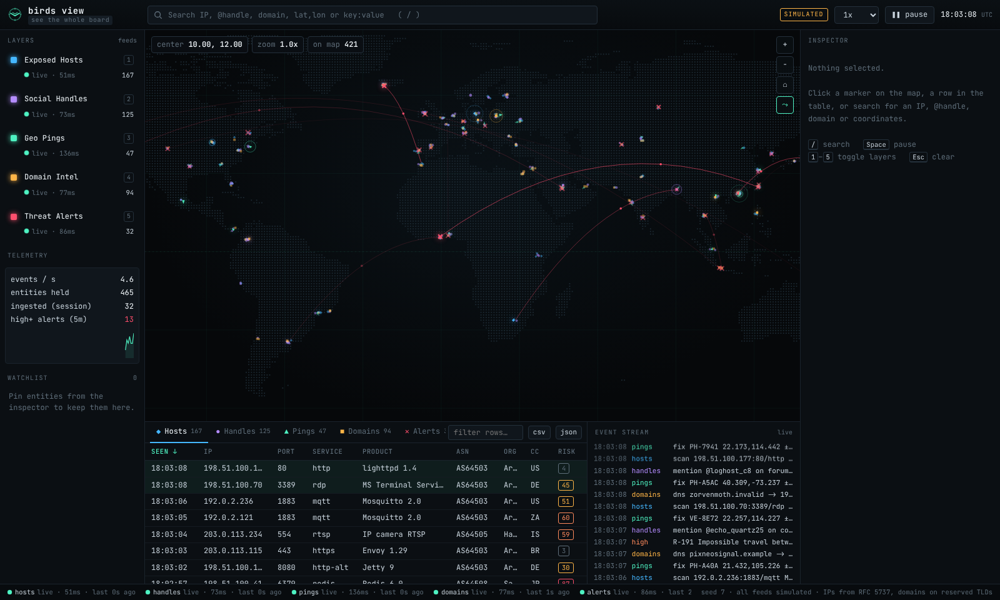

# birds view

**Live:** https://imjarvissingh.github.io/bird-view/



Watch a simulated world, live. birds view puts eleven data streams on one rotating 3D globe
(or a flat map): air traffic, shipping, satellites, earthquakes, wildfires, tropical storms,
threat alerts, exposed hosts, domain intel, social handles and device pings. You can spin
the Earth, zoom from the whole planet down to a city, click any marker or country, follow
a moving aircraft or ship, or let the tour fly you between hotspots.

**Everything is simulated in your browser.** Nothing is real and no data is fetched.
Flights fly great-circle routes between real airports; ships sail real shipping lanes;
satellites follow real orbital mechanics; quakes come from real plate-boundary regions;
fires from fire-prone regions; storms form in real cyclone basins and recurve poleward.
Operators, vessels, satellites and storm names are fictional. IP addresses use only the
RFC 5737 documentation ranges, ASNs the RFC 5398 range, and domains only reserved TLDs.
Movement is time-compressed so it is visible: aircraft 30x, ships 420x, satellites 6x, storms 900x.

## Run it

No install, no build, works offline.

- Open the live link above, or
- download the repo and **double-click `index.html`**, or
- serve the folder: `python3 -m http.server 8080` then open http://localhost:8080

`index.html?seed=42` makes the simulation reproducible. The URL hash (`#lat,lon,zoom,g|f`)
keeps the current view, so you can share a link to a spot on the globe.

## Use it

| Action | How |
|---|---|
| Explore | drag to spin or pan, scroll or pinch to zoom, double-click to zoom in, arrow keys to rotate |
| Inspect | click a marker; click a country for a briefing of everything inside it |
| Search | `/` or Ctrl/Cmd+K: `Japan`, `LHR`, `Tokyo`, `NHR123`, `M6`, `@ghost`, `35.68, 139.69` |
| Filters | `mag:>5`, `layer:flights to:JFK`, `kind:tanker`, `sev:crit`, `risk:>70`, `port:6379` |
| Follow | select a flight, ship, satellite or storm, then **F** or the follow button |
| Tour | **T** or ▶ flies between the biggest events; Esc stops |
| Views | **G** globe/flat, **H** whole world, **N** day/night, **L** labels, **K** tracks, **R** auto-rotate |
| Layers | click in the Layers panel or press `1`–`0`; group headers toggle a whole group |
| Pause / speed | **Space**, or the 0.5x–4x selector |
| Export | `csv` / `json` exports the current table tab with its filter applied |
| Help | **?** |

Layer visibility, view toggles, speed and map mode are remembered in your browser.

## Add a data layer

1. Copy `js/layers/quakes.js` (static events) or `js/layers/flights.js` (moving things) to
   `js/layers/yourlayer.js` and change `id`, `label`, `color`, `generate()` and `columns`.
2. Add `<script src="js/layers/yourlayer.js"></script>` with the other layers in `index.html`.

The globe, table tab, search, inspector, stream, layer panel and feed status pick it up
automatically. The layer contract is in `docs/02-architecture.md`. To use a real API, replace
the layer's feed in `js/core/mockapi.js`; the UI only talks to `BV.store` and `BV.server.query()`.

## Layout

```
index.html              app shell
css/birdsview.css       Night Heron theme + layout (desktop to phone width)
js/vendor/              d3-geo, d3-array, topojson-client (vendored, ISC licensed)
js/core/                rng, event bus, layer registry, store, geo helpers, MockServer
js/data/                Natural Earth borders (110m + 50m, public domain), airports, lanes, seismic/fire/storm regions, cities
js/layers/              flights, vessels, satellites, quakes, fires, storms, alerts, hosts, domains, handles, pings
js/ui/                  globe, panels (layers, telemetry, watchlist, inspector, stream, footer), table, search
js/app.js               bootstrap, controls, keyboard, preferences, help
docs/                   recon, architecture, brand notes
```

## Live data (v3)

Layers in the **Live** group use real public, keyless sources and fall back to their simulated twins if a source is unreachable:

| Layer | Source |
|---|---|
| Live Flights | adsb.lol / airplanes.live (ADS-B, around where you look and across major hubs), OpenSky when available; routes and photos from adsbdb |
| Live Earthquakes | USGS real-time feeds |
| Natural Events | NASA EONET (wildfires, storms, volcanoes, floods, ice …) |
| Live Satellites | CelesTrak elements propagated with SGP4 (satellite.js) |
| Live News | GDELT headlines, placed by the place named in the headline |

Also: **Live TV** (`B`, 16 news channels via YouTube embeds), **Street view / satellite / weather** for any selection, country click or map center (`V`). Ships, cyber and people layers remain simulated (no free keyless AIS exists). Embeds and APIs need internet access and a normal browser; some hosts (sandboxed previews) block them.
